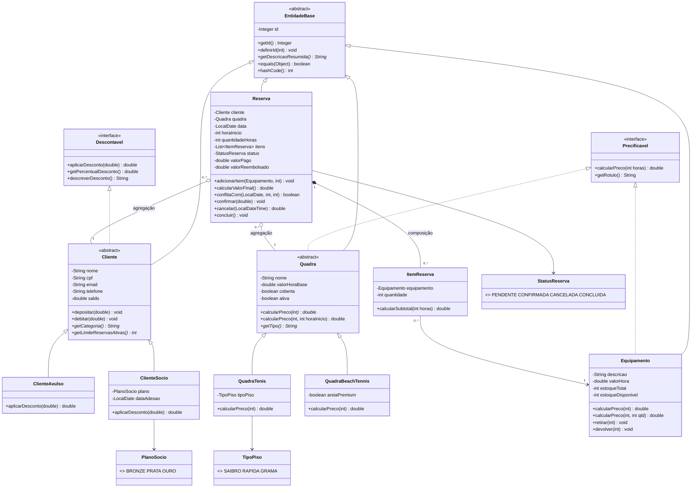
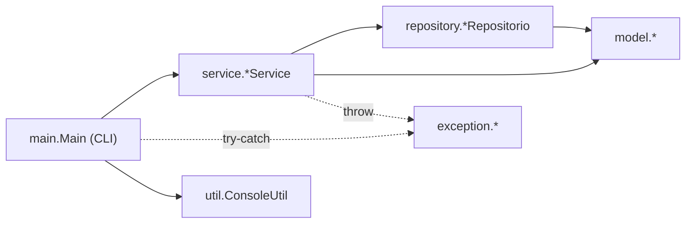

# Arena Smash — Sistema de Reserva de Quadras (Tênis / Beach Tennis)

Projeto acadêmico de POO em **Java 17 puro**, CLI, persistência em memória (Collections).

## Como executar

**Windows (duplo clique):** `executar.bat`

**Manual (qualquer SO):**
```bash
# Windows (cmd)
dir /s /b src\*.java > fontes.txt
# Linux/macOS
find src -name "*.java" > fontes.txt

javac -encoding UTF-8 -d out @fontes.txt
java -cp out main.Main
```
> Acentos quebrados no terminal do Windows: rode `chcp 65001` antes (o `.bat` já faz isso).

---

## 1. Diagrama de Classes



### Camadas



| Repositório | Herda de | Interface |
|---|---|---|
| `ClienteRepositorio`, `QuadraRepositorio`, `EquipamentoRepositorio`, `ReservaRepositorio` | `RepositorioMemoria<T>` (abstrata, `LinkedHashMap<Integer,T>`) | `Repositorio<T extends EntidadeBase>` |

| Exceção | Tipo | Uso |
|---|---|---|
| `RegraNegocioException` | unchecked (`RuntimeException`) | base de regras de negócio |
| `DadoInvalidoException` | unchecked, herda da anterior | setters/construtores |
| `HorarioIndisponivelException` | unchecked, herda da anterior | conflito de agenda |
| `EntidadeNaoEncontradaException` | **checked** (`Exception`) | busca por ID/CPF |
| `SaldoInsuficienteException` | **checked** (`Exception`) | débito na carteira |

---

## 2. Estrutura de Diretórios

```
projetopoo/
├── executar.bat
├── README.md
├── GUIA_DEFESA.md
└── src/
    ├── main/
    │   └── Main.java
    ├── model/
    │   ├── EntidadeBase.java          (abstract)
    │   ├── Precificavel.java          (interface)
    │   ├── Descontavel.java           (interface)
    │   ├── Cliente.java               (abstract)
    │   ├── ClienteAvulso.java
    │   ├── ClienteSocio.java
    │   ├── Quadra.java                (abstract)
    │   ├── QuadraTenis.java
    │   ├── QuadraBeachTennis.java
    │   ├── Equipamento.java
    │   ├── Reserva.java
    │   ├── ItemReserva.java
    │   ├── PlanoSocio.java            (enum)
    │   ├── TipoPiso.java              (enum)
    │   └── StatusReserva.java         (enum)
    ├── repository/
    │   ├── Repositorio.java           (interface genérica)
    │   ├── RepositorioMemoria.java    (abstract genérica)
    │   ├── ClienteRepositorio.java
    │   ├── QuadraRepositorio.java
    │   ├── EquipamentoRepositorio.java
    │   └── ReservaRepositorio.java
    ├── service/
    │   ├── ClienteService.java
    │   ├── QuadraService.java
    │   ├── EquipamentoService.java
    │   ├── ReservaService.java
    │   └── RelatorioService.java
    ├── exception/
    │   ├── RegraNegocioException.java
    │   ├── DadoInvalidoException.java
    │   ├── HorarioIndisponivelException.java
    │   ├── EntidadeNaoEncontradaException.java
    │   └── SaldoInsuficienteException.java
    └── util/
        ├── ConsoleUtil.java
        ├── Validador.java
        └── Formatador.java
```

## 3. Regras de Negócio

| Regra | Onde |
|---|---|
| Funcionamento 07:00–22:00, reserva de 1 a 3h | `Reserva.validarHorario` |
| Sem conflito de horário na mesma quadra | `ReservaService.validarDisponibilidade` |
| Não reservar no passado | `ReservaService.validarDataFutura` |
| Limite de reservas ativas: Avulso 2 / Bronze 3 / Prata 4 / Ouro 5 | `getLimiteReservasAtivas()` (polimórfico) |
| Tênis: base × horas × fator piso (+R\$ 25/h coberta) | `QuadraTenis.calcularPreco` |
| Beach: base × horas (+R\$ 15/h coberta, +R\$ 10/h areia premium) | `QuadraBeachTennis.calcularPreco` |
| Acréscimo de 20% nas horas a partir de 18:00 | `Quadra.calcularPreco(int,int)` (final) |
| Desconto: Avulso 0% / Bronze 10% / Prata 20% / Ouro 30% | `aplicarDesconto()` (polimórfico) |
| Pagamento debitado do saldo; sem saldo → exceção | `Cliente.debitar` |
| Cancelamento ≥ 24h: reembolso 100%; < 24h: 50% | `Reserva.calcularValorReembolso` |
| Estoque de equipamentos retirado na reserva e devolvido no cancelamento/conclusão | `ReservaService` |
| CPF único e validado (dígitos verificadores) | `ClienteService.salvarNovo` / `Validador.validarCpf` |

## 4. Dados da carga inicial (`popularDadosIniciais`)

| ID | Cliente | Categoria | Saldo inicial |
|---|---|---|---|
| 1 | Ana Souza | Sócio Ouro | R\$ 500 |
| 2 | Bruno Lima | Sócio Prata | R\$ 300 |
| 3 | Carla Mendes | Avulso | R\$ 200 |
| 4 | Diego Rocha | Avulso | R\$ 30 (demonstra `SaldoInsuficienteException`) |

Quadras: 1 Central Saibro, 2 Rápida Coberta, 3 Arena Beach 1, 4 Arena Beach Premium.
Equipamentos: 1 Raquete de Tênis, 2 Raquete de Beach Tennis, 3 Tubo de Bolinhas.
Reservas: 3 já confirmadas para amanhã/depois de amanhã (relativas à data de execução).
